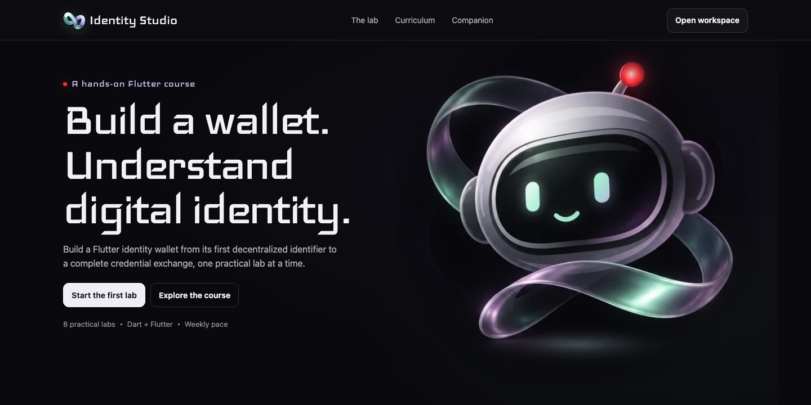
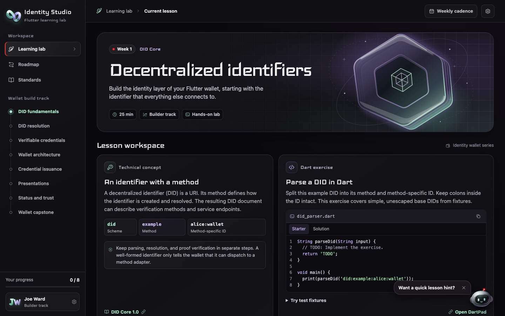

<p align="center">
  
</p>

<h1 align="center">Identity Studio</h1>

<p align="center">
  <b>Build a wallet. Understand digital identity.</b><br>
  A hands-on Flutter course · 8 practical labs · Dart + Flutter · Weekly pace
</p>

<p align="center">
  
</p>

Build a Flutter identity wallet from its first decentralized identifier to a complete credential exchange, one practical lab at a time.

## The lab

**Read it. Run it. Build it into your wallet.** Each lab starts with a concept, lets you try it on a fixture, then takes the next step in your Flutter project, with Dart starter code and an explained solution.

<p align="center">
  
</p>

## Curriculum

Three phases, one project.

| Phase | Week | Lab | Standard |
|---|---|---|---|
| **Identity** | 1 | DID fundamentals | DID Core 1.0 |
| | 2 | DID resolution | DID Resolution 1.0 |
| **Wallet** | 3 | Verifiable credentials | Verifiable Credentials 2.0 |
| | 4 | Wallet architecture | Flutter App Architecture |
| **Exchange** | 5 | Credential issuance | OpenID4VCI 1.0 |
| | 6 | Presentations | OpenID4VP 1.0 |
| | 7 | Status and trust | Bitstring Status List 1.0 |
| | 8 | Wallet capstone | All of the above |

## Studio companion

A little help when you're stuck: ask for a recap, a coding hint or a next step. The companion's replies come from the lessons, so it works offline and needs no account.

## Run it

No build step and no dependencies. `dist/` is the site.

```sh
python3 -m http.server 3400 -d dist
```

Then open <http://localhost:3400>. Any static host works the same way: point it at `dist/`.

> Serve it rather than opening `index.html` as a file, because browsers block the shared icon sprite on `file://`.

Your progress is saved in the browser's `localStorage`, so there's nothing to sign in to.

## Project layout

```
dist/
├── index.html            entry point: home page and lesson workspace
├── style.css             workspace layout and design tokens
├── home.css · home.js    home page
├── app.js                router, lesson workspace, progress
├── lessons.js            the 8 labs and the standards they cite
├── companion.css · .js   studio companion
├── *.svg · *.webp        brand mark, icons, illustrations
└── fonts/                Iceland (SIL OFL 1.1)
docs/screenshots/         images for this README
```

## Design system

Dark glass surfaces, mint for progress, purple for exercises, a single red signal for "now". Tokens live at the top of `dist/style.css`.

| Token | Value | Used for |
|---|---|---|
| `--canvas` | `#0a0a0d` | page background |
| `--surface` | `#151519` | glass cards |
| `--raised` | `#1b1a20` | raised controls |
| `--ink` | `#f2f2f4` | primary text |
| `--muted` | `#b1b0b8` | body text |
| `--dim` | `#90909d` | labels |
| `--mint` | `#a9e8ca` | progress, links, focus ring |
| `--purple` | `#c8b9ef` | exercises, spec labels |
| `--accent` | `#ff2c2c` | the current-week signal |

**Type:** [Iceland](https://fonts.google.com/specimen/Iceland) for display headings and labels, Inter or the system sans for body text, SF Mono for code.

## License

The Iceland font is licensed under the SIL Open Font License 1.1 (`dist/fonts/iceland-OFL.txt`).

---

## ⚠️ DISCLAIMER ⚠️

> ⚠️ **THIS IS A FAKE WEBSITE, CREATED FOR LEARNING PURPOSES TO IMPROVE MY PROMPT ENGINEERING WITH AI. EVERYTHING ABOVE WAS CREATED WITH A SINGLE PROMPT TO CODEX.** ⚠️
